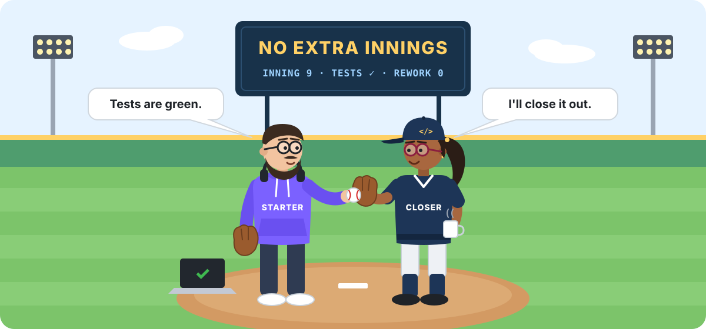
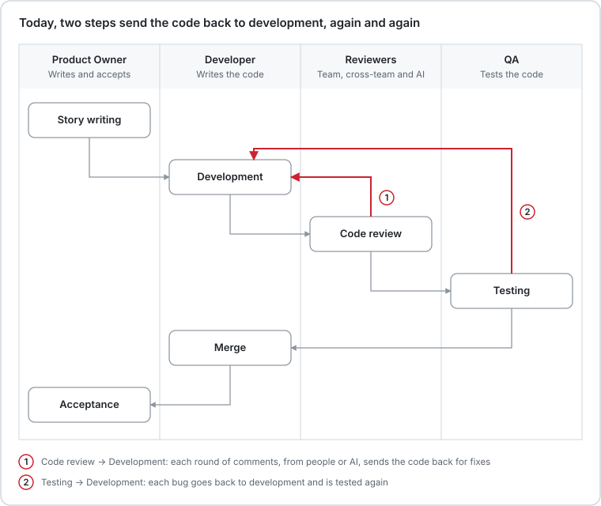
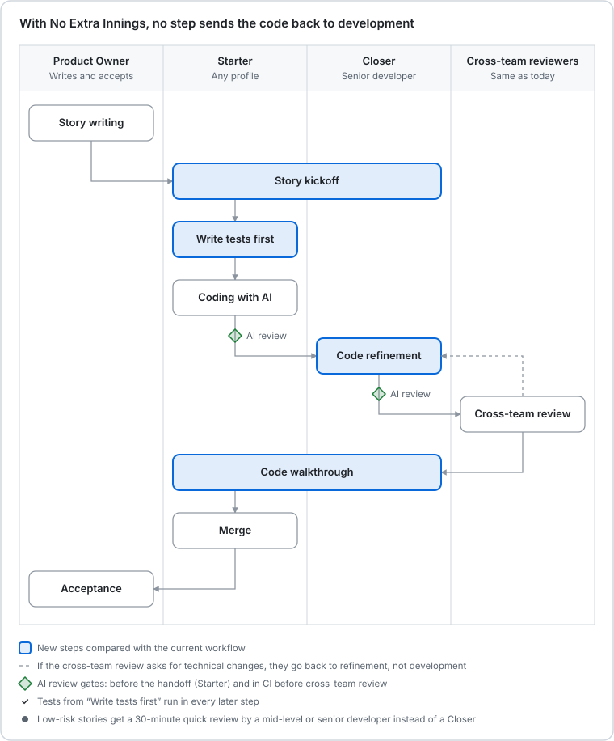
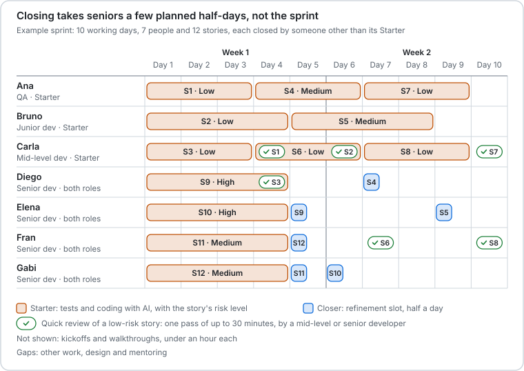

  

<h1 align="center">No Extra Innings</h1>

<strong>Start strong. Close clean. No extra innings.</strong>

A development workflow for the vibe coding era.

---

## In one minute

**Code review, flipped: the reviewer makes the changes, and the author reviews them.**

Today a reviewer writes comments, the author fixes them, and the code goes around again; every bug QA finds sends it around once more. With AI producing more code than ever, those rounds have become the bottleneck.

- The **Starter** writes the tests first and builds the feature with AI until they pass.
- The **Closer**, a senior developer, improves the code in one time-boxed pass instead of describing the fixes in comments. Low-risk stories get a 30-minute quick review instead.
- The **Starter reviews every change** at a short walkthrough, and the tests catch anything that breaks the agreed behavior.
- A **kickoff** before any code aligns them on the approach. Senior time is booked at sprint planning and sized by each story's risk, and the team commits only to what it can close, so work does not pile up waiting for review.

In baseball, a game that is still tied after nine innings goes into extra innings: more time, more pitchers, more risk. Today every change goes into extra innings, with another round of review and another round of testing. Here the Starter opens the game, the Closer finishes it, and the story ends in regulation.

It also keeps juniors in the game: a junior can be the Starter and learns from a senior on every story.

> **Status:** an early proposal, not yet validated with real data. Its pieces come from well-known practices, and the numbers in the example are illustrative. If you try it, please [share what you learn](https://github.com/scarabinoalbano/no-extra-innings/issues).

## The problem: two rework loops

The first loop repeats with every round of review comments. The second repeats every time QA finds a bug and the change goes back to development. Each round means waiting, switching context and reviewing again.

AI has made both loops bigger. In its [AI Productivity Paradox Report 2025](https://www.faros.ai/blog/ai-software-engineering), Faros AI analyzed telemetry from more than 10,000 developers on 1,255 teams. On teams with high AI adoption, developers completed 21% more tasks and merged 98% more pull requests. But those pull requests were 154% larger, review time grew 91% and bugs per developer rose 9%. The report calls human approval "a critical bottleneck", and the gains did not carry over to company-level throughput, DORA metrics or quality.

AI code review adds to the first loop. An AI reviewer comments on every pull request, and each finding is one more fix and often one more round. In one industry study at Beko, developers resolved 73.8% of an LLM review bot's comments, and the average time to close a pull request grew from 5 h 52 min to 8 h 20 min. Practitioners also reported faulty reviews, unnecessary corrections and irrelevant comments ([Cihan et al.](https://arxiv.org/abs/2412.18531)).

## The workflow

### Roles

| Role | Who can take it | Responsibility | Output |
| --- | --- | --- | --- |
| Product Owner | Product Owner | Writes the user story and acceptance criteria; accepts the result if the team uses that step | User story with acceptance criteria |
| **Starter** | Any profile: QA, junior, mid-level or senior developer | Turns the acceptance criteria into tests, builds the feature with TDD and AI, and reviews the Closer's changes | A feature that meets the acceptance criteria, with all tests passing |
| **Closer** | A senior developer | On medium- and high-risk stories, sets the guidelines at the kickoff and improves the code: design, readability, performance, security and fit with the architecture | Production-ready code, with all tests passing |
| Quick reviewer | A mid-level or senior developer | On low-risk stories, one time-boxed pass that fixes small things directly | Approval |
| Cross-team reviewers | The same people as today | Independent technical review, especially in critical areas | Technical approval |

**The Starter is a role, not a level.** In US sports, a starter is a first-string player, not a beginner. A technical QA brings what they do best: knowing how the system should behave and how it can fail. A junior developer learns at every walkthrough. A senior can be the Starter on one story and the Closer on another.

**Juniors stay in the game.** A common worry about AI coding is that it removes the entry-level work juniors used to learn from, and with it the path to becoming a senior. A Stanford study found that employment of 22- to 25-year-olds in AI-exposed jobs such as software development fell 13% through July 2025, while it held steady or grew for older workers in the same jobs ([LeadDev](https://leaddev.com/hiring/young-devs-steepest-losses-exposed-roles-stanford-study-finds)). No Extra Innings keeps that path open. A junior takes the Starter role on real stories: they agree on the approach with a senior at the kickoff, build with AI against tests, and see at the walkthrough exactly what the senior changed and why. Every story becomes a short apprenticeship.

**The Closer is a senior specialist.** In baseball, the starter pitches most of the game and the closer comes in to finish it. Closing takes the judgment that tests do not cover: architecture, maintainability, performance and security. Closers only take medium- and high-risk stories, and refinement is time-boxed in hours, so closing takes a few planned slots per sprint, not the senior's week. It is not a full-time position either: seniors keep building the most complex stories as Starters, and another senior closes them.

### Risk levels

At sprint planning, the team gives every story a risk level, with the Closer's input. **Every story gets a human review before the merge.** The level decides how deep that review goes and who does it, so senior time goes where it matters.

| Risk | Typical stories | Kickoff | Closing | Cross-team review |
| --- | --- | --- | --- | --- |
| Low | Small changes in familiar, well-tested code | The Starter fills in the brief alone | Quick review: one pass of up to 30 minutes by a mid-level or senior developer | If your organization requires it |
| Medium | Most features | 20–30 minutes with the Closer | Refinement by a senior Closer, up to 2 hours | If the kickoff brief or your organization requires it |
| High | Payments, security, personal data or architecture | 20–30 minutes with the Closer | Refinement by a senior Closer, up to half a day | Always |

The quick reviewer also fixes rather than comments. Anyone can raise a story's level at the kickoff or the quick review if it turns out riskier than expected. The time boxes are a starting point: adjust them after the pilot.

### Step by step

1. **Story writing** · Product Owner. Ends with acceptance criteria and known edge cases. At sprint planning, the team gives the story a [risk level](#risk-levels) and books its people and slots.
2. **Story kickoff** · Starter and Closer, 20–30 minutes, for medium- and high-risk stories. They agree on the approach and the guidelines for the AI before any code exists. Ends with a [kickoff brief](templates/kickoff-brief.md). For low-risk stories, the Starter fills in the brief alone.
3. **Write tests first** · Starter. Turns the acceptance criteria into automated tests, which still fail.
4. **Coding with AI** · Starter. Generates the code, following the kickoff brief, until all tests pass. Before the handoff: CI green and an **AI review** of the diff against the brief, with every finding fixed or explained. The pull request carries a short note with decisions and open questions.
5. **Code refinement** · Closer, time-boxed: up to 2 hours for medium risk and half a day for high. Improves the code directly, with no comment rounds, and may restructure it. Any behavior change is agreed with the Starter. This is refinement of the code, not Scrum's backlog refinement. Low-risk stories get a **quick review** instead: one pass of up to 30 minutes by a mid-level or senior developer.
6. **Cross-team review** · The same reviewers as today, wherever the risk level or your organization requires it (always for high risk), once the **AI review in CI** has passed. If they ask for technical changes, the Closer applies them: nothing goes back to development.
7. **Code walkthrough** · Starter and Closer, 15–20 minutes. The Closer explains what changed and why, and the Starter reviews every change and confirms the behavior. For low-risk stories and small changes, the Starter reviews the diff and the tests instead. Both follow the [walkthrough checklist](templates/pull_request_template.md#walkthrough).
8. **Merge** · Starter.
9. **Acceptance** · Product Owner, if your team uses this step. Scrum does not require it: an item that meets the Definition of Done needs no further approval ([Scrum.org](https://www.scrum.org/resources/blog/definition-done-theses)).

### The kickoff brief

The kickoff produces a one-page brief stored in the repository next to the code, for example in `docs/briefs/`, and linked from the pull request. The coding agent uses it as context, the AI review checks the code against it, and the Closer refines with it as a reference.

It covers the technical approach, conventions, AI setup (agent, skills or rulesets, MCP tools, reference files), test plan, critical areas and the "ready for refinement" checklist. **[Copy the template →](templates/kickoff-brief.md)**

Skills and rulesets are chosen story by story. For example, a ruleset like [Ponytail](https://github.com/DietrichGebert/ponytail), which pushes the agent to write as little code as possible, leaves less to refine.

### The pull request template

The pull request is where the handoff happens. Its template has three parts: the Starter's note (decisions, open questions and any AI review finding left unfixed), the Closer's summary of what changed and why, and the walkthrough checklist both use before the merge. **[Copy the template →](templates/pull_request_template.md)**

### Working agreements

- **Tests are the contract.** The Closer never changes them silently; behavior changes are agreed with the Starter.
- **Tests get a second pair of eyes.** The Closer reviews the test plan at the kickoff and the tests during refinement, and risky stories still get exploratory testing from someone other than the Starter.
- **Senior time is planned.** Every story leaves sprint planning with its risk level, its Starter, its Closer or quick reviewer, and a reserved slot. Nobody gets review or refinement work by surprise.
- **Refinement is time-boxed.** Up to 2 hours for medium risk and half a day for high. Running over is a signal to fix the kickoff brief or the exit conditions, not to give the Closer more time.
- **Closer capacity sets the pace.** At sprint planning, the team commits only to the stories it can close that sprint: Closer hours for medium and high risk, quick-review slots for low. The rest wait in the backlog, not in someone's review queue. This works because closing is a single, time-boxed pass: an unknown number of review rounds can't be booked in advance, but a refinement slot can.
- **The Closer is free to rewrite.** Forcing them to keep the Starter's structure would bring the iterations back.
- **Ask before changing what you don't understand.** If the Closer can't tell why the code does something, they ask the Starter before changing it. The Starter's note records the main decisions and their reasons, so this should be rare.
- **Nothing is handed off with a red CI.** Automated review comes before any person.
- **AI findings never start a round.** Whoever holds the code fixes them: the Starter clears the AI review before the handoff, fixing each finding or explaining it in the note, and the Closer handles what the AI review in CI finds.
- **Lessons feed the AI.** Anything the Closer fixes more than once goes into the agent's instructions file, so the next build avoids it.
- **Design questions are discussed live,** in a short call, not in comment threads.
- **Small batches.** Large work is split before building, so every handoff fits its time box.
- **Critical areas always go through cross-team review:** payments, security, personal data and architecture changes.
- **Ownership is shared and explicit.** The Starter owns behavior; the Closer owns code quality.

## Example: a planned sprint

Seven people, twelve stories, ten working days. Durations are illustrative: three days of building per story, and four for complex ones and for the junior's stories. Six stories are low risk, four medium and two high.

| Risk | Stories | Closing | Who closes |
| --- | --- | --- | --- |
| Low | S1, S2, S3, S6, S7, S8 | Quick review, up to 30 minutes | Carla reviews Ana's and Bruno's; Fran and Diego review Carla's |
| Medium | S4, S5, S11, S12 | Refinement, up to 2 hours | Diego (S4), Elena (S5), Gabi (S11), Fran (S12) |
| High | S9, S10 | Refinement, up to half a day, plus cross-team review | Elena (S9), Gabi (S10) |

Each senior builds one complex story as Starter and spends 3 to 8 hours of the sprint closing other people's stories. The rest goes to their own work, design and mentoring, so the plan would also work with fewer seniors.

### Senior time: an illustration

These figures are not results. They assume that today each story gets 3 review rounds of 45 minutes of senior time, plus 2 testing rounds. In No Extra Innings, a kickoff takes 30 minutes, a walkthrough 20, a quick review 30, and refinement 2 hours for medium risk and 4 for high. Replace them with your own baseline.

| Per sprint (12 stories) | Current workflow | No Extra Innings |
| --- | --- | --- |
| Senior time on review and refinement | 27 hours (12 × 3 × 45 min) | 22.5 hours |
| How that time arrives | 36 unplanned review rounds | 21 planned sessions |
| Stories reviewed by someone other than the author | All 12, in 3 rounds each | All 12, in one pass |
| Stories that take senior time | All 12 | 9: 6 closed and 3 quick reviews; a mid-level developer reviews the other 3 |
| Times the code goes back to its author | 36 (12 × 2 from review + 12 × 1 from testing) | Only in exceptional cases |

Both columns use the same 12 stories, so the example does not assume that the new workflow handles more work. Senior time stays about the same or drops a little, from about 2.25 hours per story to 1.9: with the same risk mix, the 27 hours spent today would close about 14 stories instead of 12.

What changes most is how that time arrives: in planned sessions on the stories that need it, instead of a constant stream of review rounds. The bigger gains are for everyone else: the Starter stops interpreting comments, the QA loop disappears and stories reach the merge sooner. Senior time should keep dropping as the Closer's fixes go into the agent's instructions.

Time boxes matter. A full day of refinement on every story would take about 100 senior hours per sprint, nearly four times today's review load. That is why refinement is time-boxed and low-risk stories get a quick review instead.

In the current workflow, returns to the author grow as N × (R − 1 + T − 1), for N stories, R review rounds and T testing rounds.

## Risks and mitigations

| Risk | Mitigation |
| --- | --- |
| The Closer becomes the new bottleneck | Closers only for medium- and high-risk stories, time-boxed refinement, sprint commitments sized to Closer capacity, and Closer load tracked from day one |
| A story is classified as low risk but isn't | Anyone can raise the level at the kickoff or the quick review; incidents feed back into how the team classifies stories |
| The Starter's work arrives so rough that refining means rewriting | A kickoff brief with clear guidelines and strict exit conditions |
| The Starter does not learn because someone else always fixes things | A walkthrough for every non-trivial change |
| The Closer changes something that was right, and nobody notices | Tests as the contract, decisions explained in the Starter's note, and the Starter reviews every change at the walkthrough |
| The Starter only tests what they thought of | The Closer reviews the test plan and the tests; exploratory testing on risky stories |
| A large refactoring skips independent review | Mandatory cross-team review in critical areas |
| Repository rules require approval from someone other than the last committer | Review branch protection rules before you start |

## FAQ

**Doesn't this remove code review?** No. It removes the back-and-forth, not the review. Every change gets:

1. A design review at the kickoff, before any code exists, for medium- and high-risk stories.
2. An AI review before the handoff.
3. A second person's review that fixes instead of commenting: refinement by the Closer, or a quick review for low-risk stories.
4. An AI review in CI.
5. The cross-team review, wherever the risk level or your organization requires it.
6. The Starter's review of every change made after the handoff, at the walkthrough or in the diff.

**What if the Closer gets something wrong?** It can happen: a Closer may "fix" something the Starter did on purpose. The Starter's note explains the main decisions and why, the tests fail if a change breaks the agreed behavior, and the Starter reviews every change at the walkthrough; the AI review in CI and, for high-risk stories, the cross-team review check it too. What can still slip through is a wrong change that no test covers and the Starter misses, the same risk as today when an author applies a wrong review comment. That is why the Closer asks before changing anything they don't understand.

**Wouldn't a well-planned code review process work just as well?** It depends on how many rounds your pull requests need. Planning fixes surprise reviews: with assigned reviewers and reserved time, the first review arrives on time. It cannot fix the rounds, because nobody knows how many times the code will come back, so the later rounds still arrive unplanned. With the assumptions in the [example](#senior-time-an-illustration), No Extra Innings takes about 1.9 senior hours per story, the same as 2.5 review rounds of 45 minutes. If your pull requests usually pass in one or two rounds, a well-planned review process costs less senior time and this workflow adds little. If they need three or more, as often happens when the author is not a senior developer and builds with AI, this workflow saves senior time and the code stops going back to its author. A traditional team can also adopt tests first, AI review and kickoffs; what is specific to No Extra Innings is that the reviewer fixes instead of commenting.

**Isn't this just shifting work onto developers?** No. They already spend that time on review rounds and comments. Here they invest it once, with direct control over the result.

**Isn't the Closer's refinement just rework under another name?** Partly, yes: refining is real work. What disappears is the loop. Instead of comments, waiting, fixes and another review, the person best placed to make the change makes it once, in a slot planned for it.

**Do seniors end up only refining?** No. They keep building the most complex stories as Starters. As Closers they are accountable for what reaches production, so their responsibility grows.

**Won't seniors be overloaded?** Not if the risk levels are respected. Only medium- and high-risk stories get a Closer, refinement is time-boxed in hours, and low-risk stories get a 30-minute quick review that a mid-level developer can do. In the example, closing takes each senior between 3 and 8 hours per sprint.

**Doesn't the capacity rule cap what AI can deliver?** It caps what enters review, not what gets delivered. That cap already exists, hidden in the review queue. In the Faros AI report, teams with high AI adoption merged 98% more pull requests, but the gains did not carry over to company-level throughput. Code written faster than it can be reviewed is not delivered sooner. It waits as an open pull request, and a reviewer racing to empty the queue reviews less carefully. No Extra Innings moves that limit to sprint planning, and raises it. Each story takes fewer senior hours to close, low-risk stories can go to mid-level reviewers, and the Closer's fixes go into the agent's instructions. To deliver more, raise the capacity to close, not the amount of code.

**Aren't seniors just cleaning up AI-generated code?** No. The Closer shapes the approach at the kickoff, before any code exists, and receives tested code built against that brief. If builds keep arriving rough, the brief or the exit conditions need fixing, not the Closer.

**What if the Starter doesn't understand all the generated code?** The Starter must be able to explain what each part does and owns the behavior, which the tests guarantee. Design judgment and internal code quality are the Closer's job.

**Is this vibe coding?** Not in the original sense of accepting AI output without reading it. The Starter writes the tests first, follows the kickoff brief and must be able to explain every part of the code.

**Isn't this pair programming?** Not exactly. The work is asynchronous except for the kickoff and the walkthrough, and each role has a different responsibility.

**Does it work for every change?** It fits best where behavior can be expressed as tests. Infrastructure or architecture changes can follow your usual workflow.

## Try it: a one-sprint pilot

1. Pick two or three medium-sized stories outside critical areas.
2. Measure a baseline on recent comparable pull requests, starting with how many review rounds each one needed. If most pass in one or two rounds, planning your reviews may be all you need.
3. Give each story a risk level and run it with a Starter and, depending on the risk, a Closer or a quick reviewer. Then hold a retrospective.

| Metric | How to measure it | Target |
| --- | --- | --- |
| Cycle time to merge | From the start of development to the merge | Below the baseline |
| Review rounds | Times the code goes back to its author | A single handoff |
| QA and development cycles | Times a change goes back for a functional bug | Close to zero |
| Senior hours | Closer and quick-review time vs. current review time | Same or lower |
| Escaped defects | Issues found at acceptance or in production | Same or lower |

## Prior art

No Extra Innings combines practices that already exist:

- **TDD and ATDD:** agreeing on acceptance tests before implementation ([Agile Alliance](https://agilealliance.org/?p=5003368)).
- **Three Amigos:** business, development and testing perspectives before, during and after development ([Agile Alliance](https://agilealliance.org/glossary/three-amigos)). The kickoff and the walkthrough follow the same idea.
- **Explore / Expand / Extract:** Kent Beck's model of how the rules change as a product matures ([The Pragmatic Engineer](https://newsletter.pragmaticengineer.com/cp/204687762)).
- **Vibe coder and cleanup specialist:** pairing a fast AI-native builder with an engineer who prepares the code for production ([Medium](https://medium.com/@jainprian/vibe-coding-cleanup-engineering-the-bridge-from-prototype-to-scale-9a44c05793c4)).
- **Spec-driven development:** agreeing on the specification before generating code, as in [GitHub Spec Kit](https://github.com/github/spec-kit) and [Kiro](https://kiro.dev).
- **AI review before human review:** now a common answer to the review bottleneck ([Georgian AI Lab](https://georgianailab.substack.com/p/review-is-the-new-bottleneck-how), [OpenAI](https://learn.chatgpt.com/guides/build-ai-native-engineering-team)).
- **Ship / Show / Ask:** Rouan Wilsenach's idea of matching the amount of review to the risk of each change ([martinfowler.com](https://martinfowler.com/articles/ship-show-ask.html)). The risk levels follow it.

What it adds, as far as we have found, is how they fit together: refining instead of commenting, senior time planned at sprint planning and sized by risk, the Starter's tests as the contract, and a kickoff brief that guides both the coding agent and the AI review.

## Contributing

Tried it? [Open an issue](https://github.com/scarabinoalbano/no-extra-innings/issues) with what worked and what didn't. Pull requests that improve the workflow, the template or the examples are welcome.

## License

[CC BY 4.0](LICENSE) © 2026 Albano Scarabino. Share and adapt it freely, with attribution.
